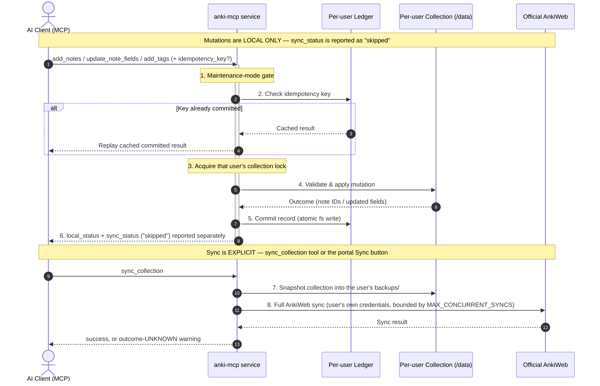

# Anki-WebMCP

> A self-hosted, headless **multi-user** Anki MCP service in Docker: one Python process serving per-user collections through the official `anki` library, a web portal for tokens and AnkiWeb sync, an admin UI, and an authenticated Streamable HTTP Model Context Protocol (MCP) endpoint for AI clients.

---

## Table of Contents

1. [Overview & Philosophy](#overview--philosophy)
2. [Prerequisites](#prerequisites)
3. [Architecture](#architecture)
4. [Write Safety & Synchronization Model](#write-safety--synchronization-model)
5. [Quick Start](#quick-start)
6. [First-Run Setup: Portal, Users & AnkiWeb](#first-run-setup-portal-users--ankiweb)
7. [Exposure Modes](#exposure-modes)
   - [Mode 1: Cloudflare Tunnel](#mode-1-cloudflare-tunnel)
   - [Mode 2: Coolify HTTPS Reverse Proxy](#mode-2-coolify-https-reverse-proxy)
8. [MCP Client Integration](#mcp-client-integration)
9. [Available MCP Tools](#available-mcp-tools)
10. [Security Architecture](#security-architecture)
11. [Troubleshooting](#troubleshooting)
12. [Operations](#operations)
13. [Testing & Verification](#testing--verification)
14. [History](#history)

---

## Overview & Philosophy

### What this is
- **One headless service** (no GUI, no browser desktop) that owns Anki collections **in-process** via the official `anki` Python library (pinned `anki==26.9.3`).
- **Multi-user by design**: every account gets its own collection, its own MCP token, and its own AnkiWeb credentials. Built for a household or small group (comfortable at 2–5 users; no hard cap).
- **Web portal and admin UI** on the same port: users log in to view/copy their MCP token, enter AnkiWeb credentials, trigger a sync, browse their decks as a collapsible tree, manage **Version history** snapshots, and control **tool access** (per-user tool-disable rules + a per-account tool activity log) on the Tools page; admins manage accounts and **global tool-disable rules** at `/admin`.
- **Official AnkiWeb Cloud Sync**, explicit and per-user.
- **Remote Streamable HTTP MCP server** at `/mcp`, authenticated with per-user bearer tokens, for AI assistants (Claude, Cursor, custom agents).

### What this is NOT
- There is **no Anki Desktop in the browser anymore** — the streamed GUI (KasmVNC) and AnkiConnect were removed in the headless redesign. **Reviewing happens on your other Anki clients** (desktop app, AnkiDroid, AnkiMobile) after an explicit sync pushes/pulls changes through AnkiWeb.
- This is **not** a replacement Anki backend, custom sync server, or web scraper.
- Mutations made through MCP are **local to the service** until an explicit sync runs — see [Write Safety & Synchronization Model](#write-safety--synchronization-model).

---

## Prerequisites

- **Docker Engine 24+ and Docker Compose v2.24+** (the exposure-mode override files use the `!override` compose tag, which requires 2.24+).
- **amd64 or arm64 host** — both are supported natively: the pinned `anki` wheel ships `manylinux_2_35` builds for x86_64 and aarch64 on the multi-arch `python:3.14-slim` base (3.14 required: snapshot restore reads the wheel's zstd-compressed backup member via the stdlib `compression.zstd` module).
- ~450 MB image and roughly **150–350 MB RAM per open collection** (the pool keeps at most `MAX_OPEN_COLLECTIONS` collections open, LRU-bounded).
- A free host port `8000` (configurable mapping).
- A Cloudflare account with a Zero Trust tunnel (only for Exposure Mode 1).
- `openssl` if you prefer choosing your own `SESSION_SECRET` and admin password — when omitted, the service generates and persists both on first boot (see [Security Architecture](#security-architecture)).

---

## Architecture

One containerized service and an optional exposure gateway:

```
┌──────────────────────────────────────────────────────────────────┐
│                         EXPOSURE LAYER                           │
│                                                                  │
│   Option A: Cloudflare Tunnel (cloudflared)                      │
│   Option B: Coolify Reverse Proxy (Traefik with Let's Encrypt)   │
└──────────────────────────────┬───────────────────────────────────┘
                               │ HTTPS
                               ▼
              ┌─────────────────────────────────┐
              │            anki-mcp             │
              │      (single service, :8000)    │
              │                                 │
              │  • Streamable HTTP (/mcp)       │
              │  • Token portal (/)             │
              │  • Admin UI (/admin)            │
              │  • Per-user auth middleware     │
              │  • CollectionRegistry + pool    │
              │  • Idempotency ledgers          │
              │  • Explicit AnkiWeb sync        │
              │  • Volume: mcp_data (/data)     │
              └─────────────────────────────────┘
```

### Component Details
1. **`anki-mcp`** (the only service):
   - Python 3.14 on `python:3.14-slim`, running the official MCP SDK (`mcp`) and the official **`anki` wheel 26.9.3** — collections are real Anki collections opened in-process, no separate app, no X11, no add-ons.
   - Serves **three surfaces on port 8000**: the Streamable HTTP MCP endpoint at `/mcp`, the user **token portal** at `/`, and the **admin UI** at `/admin`.
   - Data layout on the `/data` volume:
     ```
     /data/users.json                     # account store (0600)
     /data/users/<username>/collection.anki2
     /data/users/<username>/collection.media/
     /data/users/<username>/backups/      # snapshots (pre-sync / destructive / manual; BACKUP_RETENTION, default 20)
     /data/ledgers/<username>/ledger.json # per-user idempotency ledger
     /data/deleted/<username>-<timestamp> # archived on account deletion
     ```
   - Non-root runtime (dedicated `anki` user, uid 1000), `/data` created `0700` in the image.
   - Sanitizes and redacts secrets from logs; `LOG_LEVEL` controls verbosity.
2. **Exposure gateway** (optional): cloudflared or Coolify's Traefik terminates TLS in front of port 8000. Direct plain-HTTP exposure beyond localhost is not recommended — see [Security Architecture](#security-architecture).

---

## Write Safety & Synchronization Model

The core change from v1: **mutations never sync automatically.** Every write is applied locally to the acting user's collection and reported immediately; changes reach other Anki clients only when an **explicit sync** runs (the `sync_collection` MCP tool or the portal's Sync button). Debounced background auto-sync is a documented backlog idea, **not implemented**.



### Safety Guarantees
- **No blind retries**: mutations are never automatically retried; an optional client-supplied `idempotency_key` gets exactly-once semantics via the per-user ledger (replays return the cached committed result or cached error).
- **One writer per collection**: all of a user's reads and writes serialize through the registry's per-user lock. Never point another Anki instance (desktop, second replica) at the same `/data` files.
- **Duplicate Prevention**: `add_notes` pre-checks each candidate against the target deck using the model's first field (exact-match search) before creating anything.
- **Crash-Window Semantics**: ledger records are flushed atomically (`tempfile` + `fsync` + `os.replace`). If a power loss lands between the collection write and the ledger commit, the first-field duplicate check prevents accidental duplicates on retry (when `allow_duplicates` is false).
- **Ambiguous-outcome semantics**: if a sync drops mid-flight with an unknown outcome, the response carries an outcome-UNKNOWN warning and the idempotency key is deliberately **not** recorded — verify collection state before retrying. Deterministic failures (e.g. duplicate rejection) do persist a `failed` record.
- **Bounded state**: the ledger keeps at most 1000 recent keys (each key capped at 256 characters); at most `BACKUP_RETENTION` snapshots per user (default **20**, env-tunable) covering pre-sync, pre-destructive-change, manual, and pre-restore snapshots; at most `MAX_OPEN_COLLECTIONS` collections open at once (idle ones close after `IDLE_TIMEOUT_MINUTES`); at most `MCP_MAX_SESSIONS` concurrent MCP sessions across all users, reaped after `MCP_SESSION_IDLE_TIMEOUT` seconds idle.

---

## Quick Start

### 1. Clone & Configure
```bash
git clone <your-repository-url>
cd Anki-WebMCP

# Copy environment template
cp .env.example .env
```

### 2. Generate Secrets (optional)
Both secrets can be omitted — the service then provisions its own on first boot and persists them (`0600`) in the `/data` volume: a generated `SESSION_SECRET` at `/data/.session_secret`, and a generated initial-admin password recorded in `/data/initial-admin-password.txt` (read it with `docker compose exec anki-mcp cat /data/initial-admin-password.txt`).

To choose your own instead, edit `.env`:
```bash
openssl rand -hex 24     # Use for SESSION_SECRET
openssl rand -base64 16  # Use for ADMIN_PASSWORD (or pick a strong passphrase)
```

Example `.env`:
```env
SESSION_SECRET=<output of: openssl rand -hex 24>
ADMIN_USERNAME=admin
ADMIN_PASSWORD=<output of: openssl rand -base64 16>
TZ=UTC
```

`ADMIN_USERNAME` / `ADMIN_PASSWORD` are **first-boot bootstrap only**: they create the initial admin when the account store is empty, and do nothing afterwards.

### 3. Start the Service
```bash
docker compose up -d --build
```

Verify it is healthy:
```bash
docker compose ps
curl http://localhost:8000/health
```

Expected health output:
```json
{"status":"healthy","service":"anki-mcp","anki_connected":true,"maintenance_mode":false,"auth_enabled":true}
```

`/health` returns **200** when healthy and **503** with `"status":"degraded"` when the users store is unavailable or the data directory is not writable — there is no slow GUI startup anymore (the Docker healthcheck grace period is 10 s).

---

## First-Run Setup: Portal, Users & AnkiWeb

1. Open **http://localhost:8000** and log in with `ADMIN_USERNAME` / `ADMIN_PASSWORD` from `.env` — or, if you set no admin password, with the generated one from `/data/initial-admin-password.txt` (`docker compose exec anki-mcp cat /data/initial-admin-password.txt`).
2. Go to **/admin** and create an account for each user (username, initial password, role). Each account immediately gets its own MCP token and empty collection.
3. As each user: log in at the portal, **copy your MCP token** (shown on the portal page; use it in your MCP client — see [MCP Client Integration](#mcp-client-integration)).
4. To connect AnkiWeb, enter your **AnkiWeb email/password** under portal → Credentials, then press **Sync**. The first sync pulls your existing collection into `/data/users/<you>/`; from then on, explicit syncs move changes between this service and AnkiWeb.
5. Reviewing happens on your normal Anki clients (desktop/AnkiDroid/AnkiMobile): sync them against the same AnkiWeb account. There is no browser-based reviewer here.

**Version history** (portal): a snapshot of the collection is taken before **every sync and every destructive change** (and via the portal's *Back up now* button). The Version history section lists the newest snapshots with timestamp, reason, and size, and each can be **restored** — restoring replaces the current collection, and the replaced state is kept automatically as a `pre-restore` snapshot, so a restore is itself reversible — or **downloaded** as a `.colpkg` file. After a restore, the next AnkiWeb sync reconciles the differences; review before syncing. Snapshots exclude media files.

**Tool access control & activity log** — every MCP tool call passes a two-layer deny gate and is usage-logged:

- **Your rules** (portal → **Tools** page, `/portal/tools`): each user can disable tools for their own account — an exact tool name (`sync_collection`) or a trailing-`*` prefix (`delete_*`, matching `delete_deck`, `delete_notes`, ...). The page also shows the account's recent tool activity (every call logged: reads, writes, and refusals, with duration and error snippets) and a live Enabled/Disabled status table for all tools.
- **Global rules** (admin console → **Global tool rules**): the admin can disable tools for **every** account (admins included). Deny-only union — a tool matched by either layer is refused; nothing can re-enable a tool matched by the global layer.
- Refused calls return a structured `ToolDisabledError` naming the matching rule and which layer it came from, so connected clients (claude.ai, Perplexity, ...) see why a tool is unavailable instead of a silent failure.
- The usage log lives per user at `/data/users/<name>/tool_usage.json` (capped at the 1000 most recent entries, atomic writes; archived with the account on deletion).

---

## Exposure Modes

Keep the core application identical while choosing your exposure strategy:

### Mode 1: Cloudflare Tunnel

Recommended for self-hosters without a public IP or open router ports.

1. Create a Tunnel in your [Cloudflare Zero Trust Dashboard](https://one.dash.cloudflare.com/) (`Networks` -> `Tunnels`).
2. Configure the Public Hostname in the Cloudflare Dashboard:
   - `anki-mcp.yourdomain.com` -> `HTTP` -> `anki-mcp:8000`
   (This single ingress rule covers `/mcp`, the portal, and `/admin`.)
3. Add your Tunnel token to `.env`:
   ```env
   CLOUDFLARE_TUNNEL_TOKEN=eyJhIjoi...
   ```
   The override file passes the token to cloudflared via its `TUNNEL_TOKEN` **environment variable** — never on the container command line, where it would be world-readable to every local account through `ps` and `/proc/<pid>/cmdline`.
   
   > **Login lockout behind a proxy**: the portal's brute-force limiter budgets per *client IP*, but behind cloudflared/Traefik the app sees only the proxy's address, so the per-IP aggregate budget (30 failures / 15 min) is shared by **all** portal users — one attacker's spray can lock portal logins (not MCP tokens) for everyone for 15 minutes. If that matters on your deployment, add a Cloudflare WAF rate-limit rule on `/login`.
4. Start with the Cloudflare override:
   ```bash
   docker compose -f docker-compose.yml -f docker-compose.cloudflare.yml up -d
   ```
5. Consider **Cloudflare Access** (Zero Trust SSO / Email OTP) in front of the hostname for an extra factor on the portal and `/admin` (MCP clients would then need to satisfy Access too).

### Mode 2: Coolify HTTPS Reverse Proxy

Recommended for self-hosters running Coolify — a paste-and-go deploy with zero secrets to enter.

0. **One-time prerequisite:** let the `docker-image` workflow publish `ghcr.io/thies2005/anki-webmcp` (it runs on pushes touching `docker/mcp-service`), then make the package public for anonymous pulls — GitHub → your profile → **Packages** → **Anki-WebMCP** → *Package settings* → *Change visibility*. Alternatively keep it private and add GHCR credentials in Coolify.
1. In Coolify: create or open a project → **+ New Resource → Docker Compose** (the empty/paste variant) — and paste the contents of [`coolify-stack.yml`](coolify-stack.yml) from this repository.
2. In the compose resource's service list, set your domain on the **anki-mcp** service (e.g. `https://anki-mcp.yourdomain.com`). Coolify generates the Traefik routing and the Let's Encrypt certificate and forwards to the container's port 8000.
3. **Deploy.** No environment variables are required and the data volume is created from the stack file: on first boot the service provisions `SESSION_SECRET` and the initial admin password itself (persisted `0600` inside the volume, reused across restarts).
4. Retrieve the generated admin password — Coolify: the resource's **Terminal/Exec** → `cat /data/initial-admin-password.txt` — log into the portal, then change the password. (To choose your own instead, set `SESSION_SECRET` / `ADMIN_PASSWORD` in the Environment editor beforehand.)
5. Verify `https://anki-mcp.yourdomain.com/health` returns `{"status":"healthy",...}`.

Git-based deploys work too: add the resource from this repository with the compose file at `/coolify-stack.yml`, swapping the `image:` line for the commented `build:` block to build from source. The advanced override (`docker-compose.coolify.yml`, explicit Traefik labels driven by `ANKI_MCP_DOMAIN`) remains for users who manage their own Traefik.

> **If the domain does not resolve after deploy:** attach the `anki-mcp` service to Coolify's proxy network in the Coolify UI, and confirm the service's port is set to 8000.

---

## MCP Client Integration

AI clients connect over the **Remote Streamable HTTP transport** at `/mcp`. **Every user uses their own token** from the portal — the token identifies which collection the tools operate on. Both `Authorization: Bearer <token>` and `X-API-Key: <token>` headers are accepted.

### Claude.ai (custom connector)
claude.ai connectors only support OAuth authentication, and the service implements the MCP authorization spec for exactly that (OAuth 2.1 authorization-code + PKCE, RFC 7591 dynamic client registration, rotating refresh tokens):

1. Settings -> Connectors -> **Add custom connector**:
   - **URL**: `https://anki-mcp.yourdomain.com/mcp`
   - **Authentication**: **OAuth 2.0** — leave "Use Claude's published identity"; no client credentials needed.
2. Click **Connect**: Claude opens the service's sign-in page. Sign in as the user whose collection Claude should operate on and click **Allow** on the consent screen.
3. The connector's access token **is** that user's MCP token; tools run against that user's collection only.

**Revoking a connector:** regenerate the user's MCP token in the portal (outstanding connector grants die at their next refresh), or change the user's password. Both also evict all of the user's grants issued before the change.

### Claude Desktop

Claude Desktop has no native remote-HTTP MCP transport, so bridge it with [`mcp-remote`](https://www.npmjs.com/package/mcp-remote). Add the following to your `claude_desktop_config.json`:

```json
{
  "mcpServers": {
    "anki": {
      "command": "npx",
      "args": [
        "-y",
        "mcp-remote",
        "https://anki-mcp.yourdomain.com/mcp",
        "--header",
        "Authorization: Bearer <user-token-from-portal>"
      ]
    }
  }
}
```

### Claude Code
```bash
claude mcp add --transport http anki https://anki-mcp.yourdomain.com/mcp \
  --header "Authorization: Bearer <user-token-from-portal>"
```

### Generic Streamable HTTP clients
- **URL**: `https://anki-mcp.yourdomain.com/mcp`
- **Headers**:
  ```http
  Authorization: Bearer <user-token-from-portal>
  Accept: application/json, text/event-stream
  ```

---

## Available MCP Tools

All tools operate on the **authenticated user's** collection — the token decides whose data is touched, and users cannot see each other's notes.

| Tool | Parameters | Description |
|---|---|---|
| `list_decks` | *none* | Lists all decks in the collection with their names and IDs. |
| `search_notes` | `query: string`<br>`limit?: int (1-100, default 50)`<br>`offset?: int (default 0)` | Search notes using standard Anki query syntax (e.g. `deck:Default tag:vocab`) with bounded pagination. |
| `get_note` | `note_id: int` | Fetches complete field values, model name, and tags for a note. |
| `get_collection_stats` | *none* | Returns reliably supported statistics: cards reviewed today, deck tree counts, and new/learn/review totals. |
| `sync_collection` | *none* | **Explicitly** synchronizes the collection with the user's AnkiWeb account (snapshot to `backups/` first, then full sync). Use this after mutations when changes should reach other clients — mutations do **not** auto-sync. |
| `add_notes` | `notes: list[NoteInput]`<br>`idempotency_key?: string`<br>`allow_duplicates?: bool` | Creates flashcards locally with duplicate detection, per-user locking, and ledger-backed exactly-once semantics. Each note's `NoteInput` takes `note_type` (canonical; `model_name` is accepted as a legacy alias), `deck_name`, `fields`, `tags`. |
| `update_note_fields` | `note_id: int`<br>`fields: dict[str, str]` | Updates specific note fields under the per-user write lock. |
| `add_tags` | `note_ids: list[int]`<br>`tags: list[str]` | Adds tags to one or more notes under the per-user write lock. |
| `create_deck` | `deck_name: string` | Creates a deck (`Parent::Child` creates subdecks); an existing name resolves to its ID. |
| `rename_deck` | `deck_id: int`<br>`new_name: string`<br>`confirm: bool` | Renames a deck (subdecks follow). *Destructive — see note below.* |
| `delete_deck` | `deck_id: int`<br>`confirm: bool` | Deletes a deck, its subdecks and all their cards (the `Default` deck can never be deleted). *Destructive.* |
| `delete_notes` | `note_ids: list[int]`<br>`confirm: bool`<br>`idempotency_key?: string` | Deletes notes and their cards by ID (missing IDs reported, not fatal). *Destructive.* |
| `remove_tags` | `note_ids: list[int]`<br>`tags: list[str]` | Removes tags from notes under the per-user write lock. |
| `list_note_types` | *none* | Lists note types with their field names and card templates. |
| `create_note_type` | `name: string`<br>`fields: list[str]`<br>`templates?: list[Template]` | Creates a note type from fields and templates (default single template when omitted); refuses an existing name. |
| `find_cards` | `query: string`<br>`limit?: int`<br>`offset?: int` | Search cards by Anki query with bounded pagination. |
| `get_card` | `card_id: int` | Retrieves a card's fields, rendered question/answer, and scheduling state. |
| `suspend_cards` | `card_ids: list[int]` | Suspends cards so they leave the review queue until unsuspended. |
| `unsuspend_cards` | `card_ids: list[int]` | Unsuspends previously suspended cards. |
| `set_due_date` | `card_ids: list[int]`<br>`days: string` | Sets cards' due date to N days from today (`"3"`) or a random range (`"0-2"`). |
| `move_cards` | `card_ids: list[int]`<br>`deck_id: int` | Moves cards to another deck (target deck must exist). |
| `get_review_queue` | `limit?: int (default 10)`<br>`deck?: string` | Fetches the scheduler's review queue with capped questions. The queue covers exactly **one** deck (subdecks included): pass `deck` (a name from `list_decks`) to review that deck; without it the collection's currently selected deck is used — `Default` and usually empty on a fresh collection. The response names the deck it came from. |
| `answer_card` | `card_id: int`<br>`rating: int (1-4)`<br>`deck?: string`<br>`idempotency_key?: string` | Answers a queued card (`1`=Again … `4`=Easy, v3 scheduler). By default the card's **own deck's** queue is consulted, so any currently due card can be answered; pass `deck` to require the card to be queued there. Only the first 50 queued cards of the deck are considered; deeper cards are refused until they surface. |
| `store_media_file` | `filename: string`<br>`data_base64: string` | Stores a media file (standard base64). **Decoded size cap: 4 MiB**; returns the actual stored name. |
| `get_media_file` | `filename: string` | Reads a media file back as base64 (files over 4 MiB are refused). |
| `list_media_files` | `limit?: int (default 200)` | Lists media filenames (sorted), capped at the requested limit. |
| `preview_note_type_change` | `new_note_type: string`<br>`note_ids?: list[int]`<br>`query?: string` (exactly one of note_ids/query) | Read-only preview of a note-type change: old/new type names, the resolved field/template mapping, and warnings listing every old field whose content would be discarded and every old template whose cards would be deleted. Run this before `change_note_type`. |
| `change_note_type` | `new_note_type: string`<br>`note_ids?: list[int]` (1-2000) or `query?: string`<br>`field_map?: map`<br>`template_map?: map`<br>`confirm: bool`<br>`idempotency_key?: string` | Moves notes to another note type with an explicit field/template mapping (new name → old name, or null to discard; omitted maps use the positional default). Unmapped old content is **discarded** and cards regenerate on the new type. *Destructive — see note below.* |
| `find_and_replace` | `search: string`<br>`replacement?: string` (0-10000)<br>`note_ids?: list[int]` (1-2000) or `query?: string`<br>`regex?: bool`<br>`field_name?: string`<br>`match_case?: bool` | Bulk find-and-replace across the fields of many notes at once (selections may span note types; `field_name` restricts to one field and is passed through without existence checks). Like `update_note_fields`, a plain content edit — no confirm gate, no snapshot. Reports the changed-note count next to the selection size, so zero-match no-ops are visible. |
| `find_duplicates` | `field_name: string`<br>`search?: string`<br>`limit?: int (1-500, default 100)`<br>`offset?: int` | Read-only duplicate report: groups notes sharing a value in `field_name` (matched case-insensitively across note types, HTML-stripped; empty values never group), optionally narrowed by an Anki search prefilter. Returns the total group count and one page of `{field_value, note_ids}` groups. |
| `get_note_type` | `name: string` | Read-only full detail for one note type: id, standard/cloze type, fields with ordinals, templates with question/answer formats, CSS, sort field, and the number of notes using it. |
| `update_note_type` | `name: string`<br>`new_name?: string`<br>`css?: string`<br>`template_updates?: list`<br>`sort_field?: string` | Edits an existing note type: rename (must not collide), replace CSS, edit existing templates (rename / question / answer), set the sort field. Rendering-level edits only — nothing is added or removed, no note content changes. |
| `add_note_type_field` | `note_type: string`<br>`field_name: string`<br>`position?: int` | Adds a new empty field, appended or inserted at a 0-based position; existing notes get an empty value. |
| `remove_note_type_field` | `note_type: string`<br>`field_name: string`<br>`confirm: bool` | Removes a field — its content is deleted on **every** note of the type (the last remaining field cannot be removed). *Destructive.* |
| `rename_note_type_field` | `note_type: string`<br>`field_name: string`<br>`new_name: string` | Renames a field within the type (template references are not rewritten). |
| `reposition_note_type_field` | `note_type: string`<br>`field_name: string`<br>`index: int` | Moves a field to a new 0-based position; note values are kept. |
| `add_note_type_template` | `note_type: string`<br>`name: string`<br>`front: string`<br>`back: string`<br>`position?: int` | Adds a card template (question/answer format), appended or inserted at a 0-based position. |
| `remove_note_type_template` | `note_type: string`<br>`template_name: string`<br>`confirm: bool` | Removes a card template — the cards generated by it are deleted (the last remaining template cannot be removed). *Destructive.* |
| `reposition_note_type_template` | `note_type: string`<br>`template_name: string`<br>`index: int` | Moves a card template to a new 0-based position; existing cards follow their template. |
| `delete_note_type` | `name: string`<br>`confirm: bool` | Deletes an **unused** note type (zero notes; types with notes are refused with the use count). *Destructive.* |
| `restore_note_type_to_stock` | `name: string`<br>`force_kind?: string`<br>`confirm: bool` | Resets a modified note type to the stock defaults — fields, templates, and CSS are all replaced, so content under mismatched stock fields can be lost. `force_kind` picks the stock type (`basic`, `basic_and_reversed`, `basic_optional_reversed`, `basic_typing`, `cloze`, `image_occlusion`); omit it to use the type's original stock kind. *Destructive.* |
| `get_deck_config` | `deck_id: int` | Read-only: shows one deck's full scheduling config dict (name, `maxTaken`, new/review daily limits, autoplay, timer, ...). A deck's config is a preset that may be shared by several decks. |
| `update_deck_config` | `deck_id: int`<br>`updates: object` | Updates a deck's scheduling preset — the `updates` object accepts only `new_per_day` (0-999), `reviews_per_day` (0-999), `max_answer_secs` (10-120), and `autoplay_audio` (bool); anything else is rejected with the valid keys listed. The preset is **shared** by every deck using it. |
| `set_card_flags` | `flag: int (0-7)`<br>`card_ids?: list[int]` (1-2000) or `query?: string` | Sets (or with `0` clears) the user flag of the selected cards (`1`-`4` classic colors, `5`-`7` user-renameable). |
| `bury_cards` | `card_ids?: list[int]` (1-2000) or `query?: string` | Buries the selected cards — they leave the queue and return automatically at the next day rollover (or earlier via `unbury_cards`). |
| `unbury_cards` | `card_ids?: list[int]` (1-2000) or `query?: string` | Unburies the selected cards. **Note:** the scheduler's unbury restores buried *and suspended* cards alike — suspended cards in the selection are unsuspended too. |
| `reposition_new_cards` | `start: int`<br>`step: int`<br>`card_ids?: list[int]` (1-2000) or `query?: string`<br>`randomize?: bool`<br>`shift_existing?: bool` | Assigns new queue positions to the selected **new** cards (`start`, then `start + N*step`); review/learning cards in the selection are ignored by the scheduler. |

*Destructive tools* (`rename_deck`, `delete_deck`, `delete_notes`, `change_note_type`, `remove_note_type_field`, `remove_note_type_template`, `delete_note_type`, `restore_note_type_to_stock`) require `confirm=true` **and always create a snapshot in `backups/` first** — if the snapshot fails, the operation is aborted (fail-closed), so every destructive change stays reversible from the portal's Version history. Raw SQL execution and arbitrary add-on passthrough remain deliberately omitted to preserve collection integrity.

---

## Security Architecture

1. **Fail-Closed Startup (with zero-touch self-provisioning)**:
   - `SESSION_SECRET` may be set explicitly; placeholder values are always refused. When it is absent, the service generates a secret once and persists it at `/data/.session_secret` (`0600`, atomic write) — stable across restarts, rotatable by deleting the file, overridable by setting the variable. If the data directory is not writable the service refuses to start rather than run on a volatile secret.
   - A fresh deployment with zero accounts bootstraps an admin before serving: `ADMIN_USERNAME`/`ADMIN_PASSWORD` are used when set; when absent, the password is generated and recorded in `/data/initial-admin-password.txt` (`0600`, same volume protection as `users.json`). A bare instance can never come up with zero accounts; if the generated password cannot be persisted, startup is refused.
2. **Accounts & Passwords**:
   - Passwords are stored only as salted **scrypt** hashes; verification is constant-time and burns equivalent work for unknown usernames (no enumeration oracle).
   - Login rate limiting: **5 consecutive failures lock the (username, IP) pair out for 15 minutes**.
3. **MCP Authentication**:
   - Per-user tokens; only their **sha256 hashes** are used for authentication (constant-time comparison).
   - `Authorization: Bearer <token>` and `X-API-Key: <token>` are the only accepted transports for the token (never query parameters).
   - Unknown paths require a valid token; only `/health` and the web-session routes are exempt.
4. **MCP Write Safety**:
   - Destructive MCP operations are **snapshot-or-abort**: `rename_deck`, `delete_deck`, `delete_notes`, `change_note_type`, `remove_note_type_field`, `remove_note_type_template`, `delete_note_type`, and `restore_note_type_to_stock` require `confirm=true` and take a snapshot into the user's `backups/` **before** touching the collection — if the snapshot fails, the operation is aborted. Portal syncs and restores are snapshot-backed the same way (a restore keeps the replaced state as an automatic `pre-restore` snapshot).
   - There is still **NO raw SQL and NO arbitrary execution** surface: every tool call goes through validated input models and registry methods only.
5. **Web Sessions**:
   - Signed, `HttpOnly` session cookies; every state-changing form carries a CSRF token bound to the session. The session cookie is `SameSite=Lax` (not strict) so the OAuth authorize flow — a cross-site top-level GET from the connector's host (e.g. claude.ai) — sees an existing session; cross-site POSTs never carry the cookie, and the login/consent forms are CSRF-protected on top.
   - When the portal is served over HTTPS through a reverse proxy, set `FORCE_SECURE_COOKIES=true` so session and flash cookies carry the `Secure` attribute (never sent over plain HTTP).
   - Deleting an account invalidates its token immediately (auth checks the store on every MCP request).
6. **OAuth authorization server** (for claude.ai custom connectors):
   - RFC 7591 dynamic registration is open but bounded: at most 250 client records, name/URI fields length-capped, request bodies capped at 64 KiB before parsing (the OAuth endpoints are reachable without a token by design).
   - Authorization codes are single-use, 60-second, PKCE-S256-bound, in-memory only. Refresh tokens are persisted only as sha256 hashes, capped at 10 per user, and rotated on every use — replaying one burns it.
   - The consent screen requires a live portal session (account must exist and predate no revocation epoch) and shows the redirect destination's host, since the client name is attacker-choosable under open registration.
   - Grant eviction: changing the user's password or regenerating the user's MCP token rejects all of that user's outstanding grants at their next refresh — a leaked connector cannot keep minting fresh tokens.
7. **Documented trade-offs (read before exposing publicly)**:
   - The portal **re-displays the raw MCP token** on demand, so tokens are stored **reversibly** in `users.json` — a must-redisplay secret cannot be hash-only. The file is `0600` on the service's volume, whose bytes are therefore token-grade sensitive. Records from before this field existed show "regenerate to view" until the token is regenerated.
   - **AnkiWeb credentials are also stored at rest** in the same `users.json` (the service must be able to sync unattended). Same file, same caveats: anyone who can read the volume can read them.
   - The service enforces a **single writer per collection**: do not open the same `/data/users/<name>/collection.anki2` from another Anki instance.
   - **Rate limiting is keyed by (username, source IP) with a proxy caveat**: the service scopes lockouts by `request.client.host`. Behind a reverse proxy or Cloudflare tunnel that address is the proxy's IP, so lockout is effectively per-username — anyone who knows a username can keep its login locked (15 min per run of 5 failures). Directly exposed instances get true per-IP scoping.
   - **HTTPS is required in front of the portal** for any non-localhost access (logins and tokens cross the wire). Use the Cloudflare or Coolify exposure modes, or your own TLS reverse proxy.
   - `/health` is intentionally unauthenticated; it reports only liveness/degradation state, never collection data.
   - In Cloudflare Tunnel mode, ingress rules live in the Cloudflare dashboard — route only port 8000.
8. **Log Redaction**: automatic filters mask Authorization headers, bearer tokens, passwords, API keys, and AnkiWeb credentials before writing to container logs.

---

## Troubleshooting

- **`/health` returns 503 / `degraded`**: the users store is unavailable (e.g. `users.json` unreadable/corrupt) or the data directory is missing/not writable (volume not mounted, permissions). Check `docker compose logs -f anki-mcp` for the `Health probe:` warnings.
- **`anki-mcp` restart-loops with `FATAL: SESSION_SECRET ...`**: the variable is still the `.env.example` placeholder (refused even though auto-generation exists), or the data volume is missing/unwritable so the secret could not be self-provisioned. Set a real secret (`openssl rand -hex 24`) or fix the volume mount.
- **First-boot admin password unknown**: when `ADMIN_PASSWORD` was not set, it was generated and stored in `/data/initial-admin-password.txt` — `docker compose exec anki-mcp cat /data/initial-admin-password.txt`. It can also be reset at any time via the `src.useradmin` CLI (below).
- **Portal login locked out**: 5 consecutive failures trigger a 15-minute lock per (username, source IP). Wait it out or correct the password; a successful login clears the counter.
- **Forgot the admin password**: use the recovery CLI from inside the container —
  ```bash
  docker compose stop anki-mcp
  docker compose run --rm anki-mcp python -m src.useradmin list
  docker compose run --rm anki-mcp python -m src.useradmin reset-password admin
  docker compose start anki-mcp
  ```
  Stop the service first: a running service holds the store in memory and would overwrite external edits on its next save.
- **Tool errors mention collection locks**: another process is writing the same `collection.anki2` (second replica, or a desktop Anki pointed at the volume). The service enforces one writer per collection — remove the competing writer.
- **Sync warnings about credentials / auth**: the user's AnkiWeb credentials are missing or were rejected — re-enter them in the portal (Credentials) and sync again.
- **Restored a snapshot and now the next sync wants to change many cards**: expected. The restore replaced the local collection with an older state, so the following AnkiWeb sync reconciles the differences between the two (uploading or pulling per object). The replaced state was kept automatically as the `pre-restore` snapshot listed in Version history — if you changed your mind, restore that snapshot to get back exactly what was there before the restore, and review the outcome before syncing again.
- **A retry unexpectedly says `Previous attempt with this idempotency key failed`**: the key was recorded as `failed` after an ambiguous loss. Use a new idempotency key; old entries age out of the 1000-entry ledger.
- **`Bind for 127.0.0.1:8000 failed: port already allocated`**: another service holds the port — change the published port in `docker-compose.yml`.
- **After upgrading the image, older Anki clients complain**: the pinned `anki` wheel version defines the collection schema; see the upgrade notes in [Operations](#operations).

---

## Operations

- **Backup**: stop the service first (`docker compose stop anki-mcp`) for a consistent snapshot —
  ```bash
  docker run --rm -v mcp_data:/data -v "$PWD":/backup alpine tar czf /backup/anki-data-$(date +%F).tgz -C /data .
  ```
  In a pinch you may rely on the automatic pre-sync snapshots in `/data/users/<name>/backups/` (kept per `BACKUP_RETENTION`) and back up live, but a stopped-service volume backup is the safe path.
- **Restore**: `docker run --rm -v mcp_data:/data -v "$PWD":/backup alpine sh -c "cd /data && tar xzf /backup/anki-data-<date>.tgz"` then `docker compose start anki-mcp`.
- **User data**: everything for a user lives under `/data/users/<username>/` (collection, media, backups). Deleting an account in `/admin` **moves** that directory to `/data/deleted/<username>-<timestamp>` — nothing is destroyed; reclaim space manually when you are sure.
- **Upgrade**:
  ```bash
  git pull && docker compose build --pull && docker compose up -d
  ```
  **Read before upgrading**: the image pins `anki==26.9.3` exactly. Anki upgrades collection schemas **one-way** — once a collection is opened by a newer wheel it cannot be opened by an older one, so **downgrades are unsupported**. Take a volume backup first, and expect the first post-upgrade sync with older Anki clients to require updating those clients.
- **Check the parser/dependency versions actually inside your built image** (`requirements.txt` floors only bite at the next rebuild — images built from older floors keep whatever they resolved at build time):
  ```bash
  docker run --rm --entrypoint python <image> -c "import importlib.metadata as md; print(md.version('python-multipart'), md.version('starlette'))"
  ```
  Pass = `python-multipart` >= 0.0.18 and `starlette` >= 0.40.0 (the security-fix floors for the pre-auth multipart parser DoS CVEs CVE-2024-53981 and CVE-2024-47874). If the image reports lower versions, rebuild (`docker compose build --pull`) and re-check.
- **Logs**: `docker compose logs -f anki-mcp`

---

## Testing & Verification

The repository includes a comprehensive unit suite covering the user store, web auth/portal/admin routes, authentication middleware, collection registry, per-user tools, sync manager, idempotency persistence, and end-to-end MCP protocol behavior (including two-user isolation over the wire):

```bash
# Set up a Python environment and run tests
python3 -m venv .venv
source .venv/bin/activate
pip install -r docker/mcp-service/requirements.txt pytest pytest-asyncio httpx

PYTHONPATH=docker/mcp-service pytest tests/ -v
```

(`httpx` is test-only — it drives the ASGI in-process transports; the service itself does not import it.)

### End-to-End Verification Checklist
- [x] Single headless image builds natively on amd64 and arm64 (manylinux `anki` wheels).
- [x] Service starts fail-closed: refuses to run without `SESSION_SECRET`, and without bootstrap credentials on an empty store.
- [x] Streamable HTTP MCP server on port 8000 requires a valid per-user bearer token.
- [x] Per-user isolation verified at protocol level: two users' sessions on one instance see only their own notes and collections.
- [x] All 47 MCP tools execute against real per-user collections with per-user locking and ledger-backed idempotency (destructive ones snapshot-or-abort).
- [x] `/health` reports 200 healthy and 503 degraded (users store unavailable / data dir not writable).

---

## History

v1 of this project ran a full **Anki Desktop GUI** in a KasmVNC-streamed container and drove it remotely over the **AnkiConnect** HTTP add-on — single-user, x86_64-only, ~4.6 GB image. The current design is the headless multi-user rewrite: the desktop (and AnkiConnect with it) was removed, collections are owned in-process by the `anki` Python wheel, and accounts, tokens, and sync are first-class. This is a **re-architecture, not an upgrade** — v1 volumes and GUI settings do not carry over.
